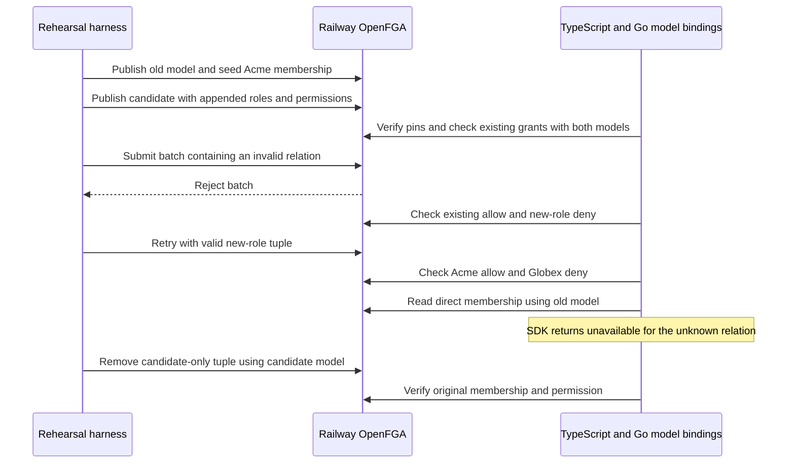

The Ledger and Support rollout cases passed against two disposable product stores on the Railway verification deployment of OpenFGA 1.22.0, deployment `cfd87a9f-da43-493c-b659-72ce4a5ba98e`. The Vitest run passed both product cases in 22.63 seconds. It ran the Go model-binding checks with `go test -race` at each stage over the same live tuples. The harness deleted both stores.

| Product | Existing grant | Old model | Candidate model |
| --- | --- | --- | --- |
| Ledger | `approver` grants `invoice.approve` | `01M7C517VK2CKC6JW993DW8RHW` | `01M7C5187RV3A8ZAZ2P3FKC2W4` |
| Support | `agent` grants `ticket.assign` | `01M7C51K1W499MJ2AHH4P0PY4X` | `01M7C51KE3F3QYZX4EZRBD14E6` |

Run ID `3f2d5162-798e-42e1-af75-f8c1d255a5a5`.



Both implementations rejected the old manifest paired with the candidate model ID. The candidate `z_reviewer` role and `z.review` permission preserved existing relation mappings. The compiler test also showed that inserting a name before the existing names reuses the original first relation. The original rehearsal did not publish that configuration. The rollout procedure and recovery limits are in [[operations#model-rollout]].

Run from the repository root with an HTTPS OpenFGA origin in `HEIMDALL_PROBE_OPENFGA_URL` and the verification credential in `HEIMDALL_PROBE_OPENFGA_KEY`. The credential needs permission to create and delete disposable stores.

```sh
HEIMDALL_PROBE_MODEL_ROLLOUT=1 pnpm --filter @heimdall/sdk exec vitest run test/model-rollout.live.test.ts --disableConsoleIntercept
```

This exercises two model and manifest versions through the current TS and Go implementations. It covers a deterministic rejected tuple batch with a corrected retry. Coordinated adapter restore and recovery after uncertain writes remain separate release checks under [[phase-7-release-qualification]].


## Provisioning inspection

Run `2fb725b0-2cf5-4848-9701-1ca1a57c61c6` repeated both live cases on Railway in 31.86 seconds. For each product, both SDKs returned a compatible report for the append-only candidate and an incompatible report for each change to ownership, relation ordinals, an existing permission's grants or an existing role's delegation. Both rejected a manifest paired with a different published model and rejected a candidate in a different store. The probe published incompatible models only in its disposable test stores and did not change live application pins. Each probe store was removed after the test.

The TypeScript check imports the provisioning entry point and invokes the Go check under the race detector with the same inputs and expected reports. See [[operations#model-rollout]] for both public APIs.


## Mixed SDK build rehearsal

Run `60403950-1172-4279-8b89-923b04b1bf4c` used ZITADEL and OpenFGA on Railway for both Ledger and Support. The harness packaged different TypeScript builds and downloaded the matching Go module versions into isolated consumer directories. The exact commits, archive digests, Go versions and model pins are recorded in `tests/integration/evidence/phase-7-mixed-sdk-builds-2026-11-14.json`.

| Role in the rollout | Source revision | Go module |
| --- | --- | --- |
| Previous build | `f2b5f19` | `v0.0.0-20261114053443-f2b5f19f5361` |
| Candidate build | `4eeddb7` | `v0.0.0-20261114054503-4eeddb78ab2e` |

Both languages authenticated a real product-audience token and exercised the public SDK with both builds. During overlap the previous build used the old pin while the candidate used both old and new pins. Existing grants and effective roles agreed, and Globex remained denied. The candidate refused a model paired with the wrong manifest at startup. After the new role tuple was written, the candidate saw both roles and the new permission. Removing that tuple restored the old effective roles and denied the new permission while preserving existing grants in both builds. The probe used real OpenFGA relationships and a test audit receipt callback. It removed the disposable stores and ZITADEL test organization.

Export the verification ZITADEL and OpenFGA variables from the [[../reference-quickstart#verify-package-integration|package integration instructions]], then run this command from the repository root.

```sh
python3 tests/integration/mixed-sdk-builds.py \
  f2b5f19f53617679b2901582656f4c519563d4dc \
  4eeddb78ab2e394b08ef9f1b6a4027188110a6bc
```

The tested build pair covers the pinned model and manifest transition through the public decision APIs. Repeat against tagged artifacts and the deployed persistence configuration before final release.
