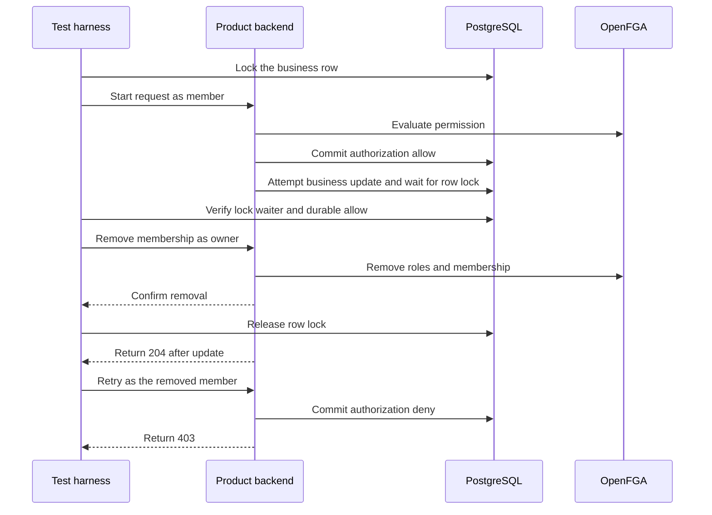

The GitHub Actions `workspace` job runs deterministic TypeScript and Go tests, package checks, and Quartz validation. The `service-faults` job runs the existing PostgreSQL and OpenFGA fault harnesses on isolated, digest-pinned PostgreSQL 17.11 and OpenFGA 1.22.0. Both SDKs share the test fixtures. The job uses disposable containers and generated credentials. Railway evidence separately exercises the deployed products and enterprise identity provider.

| First-release dry run | Evidence and remaining checks |
| --- | --- |
| Support sign-in after Ledger | The [[phase-2-oidc]] probe asserts each token has its intended project audience and excludes the other audience. [[phase-4-reference-backends]] verifies independent product sessions and scoped read decisions. [[phase-7-tenant-matrix]] records the same user signing into Support after receiving Ledger access and verifies denial before an explicit Support grant. |
| Acme route with a Globex resource ID | [[phase-4-reference-backends#phase-7-verification]] records scoped HTTP 404 in both business mutation routes. |
| Confirmed membership removal with stale role tuples | [[phase-4-reference-backends]] verifies denial with a stale owner tuple and no membership on Railway. [[phase-5-membership-administration]] verifies removal and resulting checks on pinned services. |
| Disabled identity and stale proof with provider outage | [[phase-3-identity-freshness]] verifies the shared freshness and provider failure behavior. [[phase-6-scim-deactivation]] verifies that a real directory disable blocks both product sessions. |
| Authorization began before revocation | [In-flight write during membership removal](#in-flight-write-during-membership-removal) covers the ordered product write, membership removal and durable decision receipts for Ledger and Support. |
| Tenant administrator supplies an unknown role | The shared membership administration test submits an unconfigured role through both public SDKs and asserts `invalid_argument` with no OpenFGA tuple write. The tests run in the pinned administration pass. |
| Ownership transfer loses a remote response | [[phase-5-ownership-transfer]] records both fault boundaries, quarantine, and recovery in both SDKs. The `service-faults` job enables the pinned provider repeat and separately exercises a stopped OpenFGA writer, credential replacement and verified onboarding recovery. |
| Password session attempts entry to a tenant that requires SAML | [[phase-6-tenant-sso-gate]] records the deployed policy denial and compliant sign-in in both products. |
| Directory disables a user | [[phase-6-scim-deactivation]] and [[phase-6-directory-job]] record two-product cleanup, tenant and directory scope, and recovery across scheduled runs. |
| SIEM unavailable | [[phase-6-audit-delivery]] verifies a sink restart and lost receipts. The `service-faults` job exercises the durable delivery and acknowledgement boundaries in the PostgreSQL outbox. |
| Local audit storage unavailable | [[phase-3-audited-decisions]] verifies failure at request and terminal receipt boundaries, including commit-response loss. The `service-faults` job exercises this against PostgreSQL. [[phase-4-reference-backends#phase-7-verification]] records both product routes returning HTTP 503 with unchanged business rows in a disposable deployment connected to Railway ZITADEL and OpenFGA. The deployed Railway products repeated the outage check with unchanged rows. See [[phase-7-release-qualification#patched-railway-reference-deployments]]. |

Run the pinned service-fault job locally from the repository root after installing workspace dependencies. It needs Node, pnpm, Go and a container runtime with Docker Compose. Port 8080 must be available for the isolated recovery deployment.

```sh
HEIMDALL_PROBE_PINNED_ADMIN=1 HEIMDALL_PROBE_SDK_RECOVERY=1 python3 tests/integration/postgres-records.py
```

See [[phase-7-release-qualification]] for the release gate status.

## In-flight write during membership removal

The reference-product probe holds a PostgreSQL row lock on the invoice or ticket. It waits for PostgreSQL to report the product's update blocked by that lock and checks that the product already committed an authorization allow with its matching request receipt. The owner then removes the member through the product's administration route. The probe checks the confirmed response and reads the current OpenFGA relationships before releasing the row lock.

The previously authorized request can finish with HTTP 204. A fresh request using the same browser session must return HTTP 403. The probe reads the business outcome from the committed row and checks both durable authorization results separately. The test uses the real reference routes and creates disposable identities, clients, stores and PostgreSQL data.



Run with the disposable-resource credentials from the [[../reference-quickstart#verify-package-integration|reference quickstart]].

```sh
HEIMDALL_PROBE_REFERENCE_PRODUCTS=1 HEIMDALL_PROBE_BUSINESS_WRITE=1 \
HEIMDALL_PROBE_REVOCATION_RACE=1 python3 tests/integration/postgres-records.py
```

Run `heimdall-records-68e9e63eb66f4e8b9f6ed6b4aa31dd7e` passed for Ledger and Support against Railway verification ZITADEL and OpenFGA and disposable PostgreSQL 17.11. Both writes committed after confirmed removal, both new requests were denied, and both authorization outcomes matched their committed request receipts. The run record is `tests/integration/evidence/phase-7-revocation-race-2026-11-14.json`.
