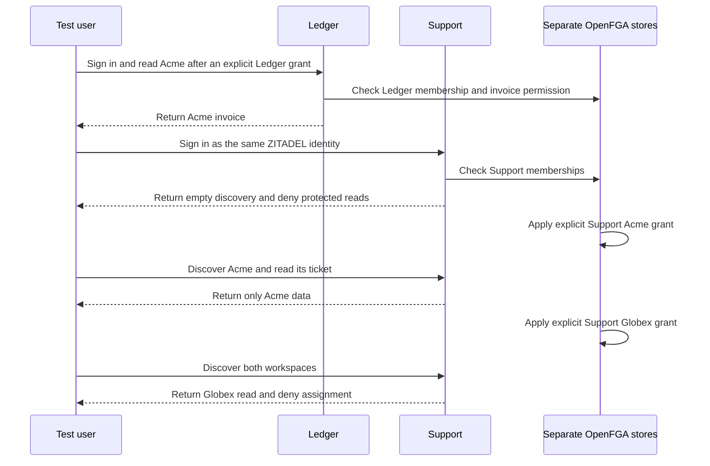

The same ZITADEL test identity signed into the Ledger and Support reference products. Each app used a distinct ZITADEL project and OpenFGA store. The probe completed Ledger first and confirmed the test user had an Acme role there. After signing into Support, the user discovered zero workspaces and both named tenant reads returned HTTP 403. Each Support workspace required its own grant.

| Product | Acme role | Globex role | Acme and Globex enforcement |
| --- | --- | --- | --- |
| Ledger | `approver` | `viewer` | Both reads returned HTTP 200. Acme approval returned HTTP 204 and Globex approval returned HTTP 403. |
| Support | `agent` | `reader` | Both reads returned HTTP 200. Acme self-assignment returned HTTP 204 and Globex self-assignment returned HTTP 403. |

The test harness creates explicit relationships in the disposable stores and inserts candidate rows so discovery can evaluate them. The products authenticate and enforce all read and write decisions through the SDK. The existing managed administration steps in the same probe separately exercise product routes for granting, assigning, removing and transferring membership roles. The named-tenant matrix uses ordinary OIDC sessions. [[phase-6-tenant-sso-gate]] covers strict tenant policies.

Run the [[../reference-quickstart#verify-package-integration|package integration probe]] with `HEIMDALL_PROBE_TENANT_MATRIX=1` alongside the documented variables.

The isolated app run `heimdall-records-3b19e97f77b741ebbd68afbfd1ec20ff` used the packed TypeScript SDK and Go module `v0.0.0-20261114050348-ca47f14b95e1`. It verified that each successful Acme write persisted the signed-in user as the actor and that both failed Globex writes left the fixture rows unchanged.
