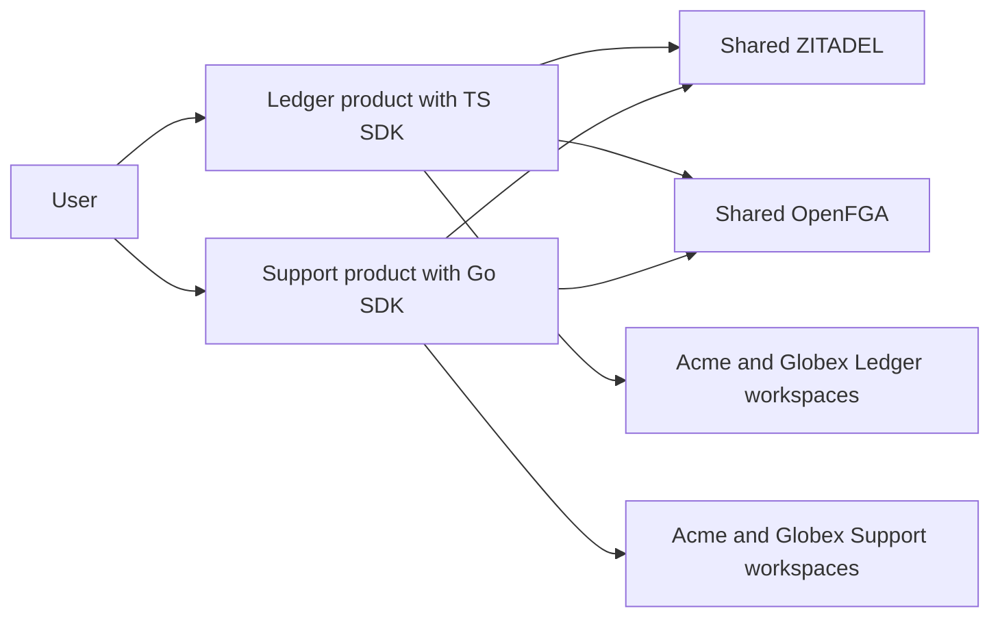

Heimdall provides shared authentication and tenant-scoped authorization through TypeScript and Go SDKs backed by ZITADEL and OpenFGA. One deployment supports multiple products, each with independent tenants, roles and enterprise identity policies.

**Start with [[design/system-design|the complete system-design specification]].** It is the entry point to the implementation source of truth: functionality, architecture, data ownership, developer wiring, end-to-end flows, failure behavior and acceptance scenarios.

## Read the specification

| Read | Purpose |
| --- | --- |
| [[design/system-design|System design and data flows]] | Understand the whole system before implementing a component |
| [[design/two-product-walkthrough|Two-product walkthrough]] | Follow setup, login, discovery and enforcement for Ledger and Support |
| [[design/index|Detailed design documents]] | Navigate architecture, tenancy, models and individual flows |
| [[design/built-in-adapters|Built-in adapters and developer wiring]] | Compare product-owned and managed workspaces, with TS/Go API sketches |
| [[design/release-contract|First-release acceptance contract]] | Required functionality and revocation guarantees |
| [[design/enterprise-contract|SSO, SCIM and SIEM]] and [[design/audit-contract|durable audit]] | Enterprise behavior, data flows and failure requirements |
| [[implementation-roadmap|Implementation roadmap and tickets]] | Build order, PRDs and verification dependencies |
| [[development-workspace|Development setup]] | Tools, commands, Git hooks and agent feedback loop |

## Design authority and delivery status

The selected design includes both SDKs, PostgreSQL adapters, tenant SSO, SCIM user lifecycle and mandatory durable audit/SIEM. [[design/decisions|Locked decisions]] and the linked contracts govern implementation. Historical explorations are separate and do not add supported scope.

The SDK runtime remains unimplemented. API sketches show what to build; service compatibility, concrete encodings and executable safety/parity tests must be completed before release.
