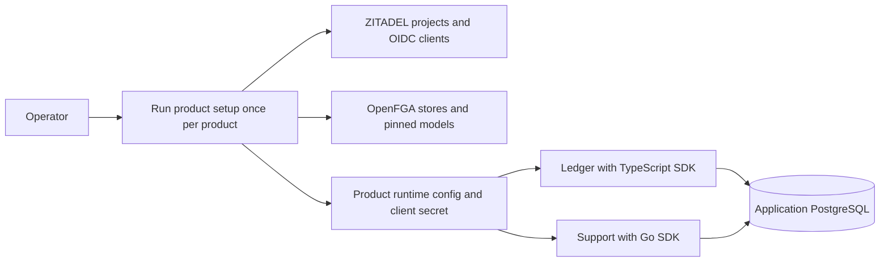

Run Ledger with the TypeScript SDK and Support with the Go SDK on one ZITADEL and OpenFGA deployment. Each has its own ZITADEL client and project audience, its own OpenFGA store and model and its own product and environment scope in PostgreSQL.



## Prepare the product

1. Start with an HTTPS ZITADEL issuer, OpenFGA endpoint, application PostgreSQL database and private deployment credentials. See the pinned service versions in `deploy/verification/versions.json`. Give the provisioning process its own PostgreSQL setup journal. Use the [[evidence/phase-5-product-setup|product setup CLI]] for each product. Generate a manifest from the Ledger or Support example in `contracts/fixtures/tenant-model-v1.json` and set `clients.web.redirectUris` to that product's HTTPS origin plus `/callback`. Keep the emitted web config with the exact manifest and put the client secret in secret storage.
2. Prepare application PostgreSQL with the shared [[evidence/phase-3-migration-runner#managed-v5-migration-on-railway|managed v5 migration sequence]]. Use the files under `contracts/persistence` from the SDK's source revision. Initialize and register the record key using [[evidence/phase-3-key-management-cli|heimdall-keys]]. Generate a separate 32-byte cursor signing key. Supply the same durable keys to replicas of the same product.
3. Apply each product's `schema.sql` and `invitations.sql`, then `approval.sql` for Ledger or `assignment.sql` for Support. Apply `examples/enterprise-provider.sql` with `product_schema` set to that product's schema. Use separate runtime and migration credentials. The business login needs scoped access to the product's tables, including the update columns named in [[evidence/phase-4-reference-backends#business-mutations]]. Enable directory and SIEM jobs with the corresponding [[evidence/phase-6-directory-job|directory setup]] and [[evidence/phase-6-siem-job|audit delivery setup]].

| Product supplies | SDK handles |
| --- | --- |
| `HEIMDALL_CONFIG`, `HEIMDALL_MANIFEST`, `HEIMDALL_CALLBACK_URL`, `HEIMDALL_POLICY_VERSION`, `HEIMDALL_ZITADEL_API_AUDIENCE` | Verify the configured client, issuer, audience and model. Bind sessions to the policy version. The ZITADEL API audience is used for user self-service evidence. |
| `HEIMDALL_CLIENT_SECRET`, `HEIMDALL_OPENFGA_KEY` | Use the configured credentials for code exchange and authorization calls. |
| `DATABASE_URL`, `HEIMDALL_KEY_DATABASE_URL`, `HEIMDALL_RECORD_KEY_ID`, `HEIMDALL_RECORD_KEYS`, `HEIMDALL_CURSOR_KEY` | Persist encrypted sessions, enforce key usage limits, audit decisions, and sign discovery cursors. `HEIMDALL_RECORD_KEYS` is a JSON map from key ID to base64 key. The cursor key is base64. |
| `LEDGER_DATABASE_URL` or `SUPPORT_DATABASE_URL` and tenant predicates in business SQL | Check permissions and release the decision after durable audit. The product writes business data. |
| `HEIMDALL_WORKSPACE_CREATOR_SUBJECT` and `HEIMDALL_REFERENCE_MEMBER_SUBJECT` in the examples | Call the product eligibility policies; serialize and audit managed workspace and membership operations. Use your product's eligibility rules when adopting the pattern. |

## Initialize managed storage

Run the following from the repository root against a fresh application database.
Set `HEIMDALL_MIGRATION_DATABASE_URL` in the migration credential's environment.
Set `AUDIT_EVENTS`, `AUDIT_BYTES`, `AUDIT_DELIVERIES`, `RETENTION_ROWS` and
`RETENTION_BYTES` to the capacity budgets for that database. Keep writers
stopped until readiness checks pass.

```sh
root=$(pwd)
cd sdk/go
go build -o /tmp/heimdall-migrate ./cmd/heimdall-migrate
session_sql="$root/contracts/persistence/session"
migrate=/tmp/heimdall-migrate

"$migrate" --initialize-session-schema --sql "$session_sql/0001.sql"
"$migrate" --initialize-managed-schema --sql "$root/contracts/persistence/managed/0001.sql"
"$migrate" --prepare-audit-upgrade --writers-drained --sql-directory "$session_sql"
"$migrate" --backfill-audit-upgrade --writers-drained
"$migrate" --activate-audit-upgrade --writers-drained
"$migrate" --prepare-capacity-upgrade --writers-drained --sql-directory "$session_sql" \
  --capacity-events "$AUDIT_EVENTS" --capacity-bytes "$AUDIT_BYTES" \
  --capacity-deliveries "$AUDIT_DELIVERIES"
"$migrate" --backfill-capacity-upgrade --writers-drained
"$migrate" --activate-capacity-upgrade --writers-drained
"$migrate" --prepare-retention-upgrade --writers-drained --sql-directory "$session_sql" \
  --retention-rows "$RETENTION_ROWS" --retention-bytes "$RETENTION_BYTES"
"$migrate" --backfill-retention-upgrade --writers-drained
"$migrate" --activate-retention-upgrade --writers-drained
"$migrate" --prepare-hold-release-upgrade --writers-drained --sql-directory "$session_sql"
"$migrate" --activate-hold-release-upgrade --writers-drained
"$migrate" --status managed-v5
cd "$root"
```

Check each backfill response before running its activation command. Continue until the audit status is `coverage_complete` or the capacity and retention phase is `complete`. Apply the runtime
grants for the adapter and features you use. See the [[evidence/phase-3-public-capacity|capacity grants]],
[[evidence/phase-3-retained-runtime|retention grants]], and [[evidence/phase-5-membership-administration|managed workspace grants]].
Install the record key ledger separately using the key deployment credential. Apply the directory migrations under `contracts/persistence/directory` in order before starting the directory job.

## Run from a clean checkout

Install Node 24, pnpm 12.10.1 and a patched Go toolchain. Go 1.26.11 is the toolchain used for the release verification. After injecting each product's environment into its own shell, use ports 18640 and 18641 behind the HTTPS origins registered in ZITADEL.

```sh
pnpm install --frozen-lockfile
pnpm run build
PORT=18640 pnpm --filter @heimdall/ledger start
```

```sh
cd examples/support
PORT=18641 go run .
```

1. Visit each product's `/auth/start` as the workspace creator. Follow the redirects back to the product. Keep the resulting cookie with requests to that product.
2. Submit `POST /workspaces` with the same product `Origin` header, `Content-Type: application/json`, a fresh `Idempotency-Key` and a body such as `{"name":"Acme"}`. Keep the returned `workspaceId` and `operationId`. Repeat with the same key and body to inspect the original operation. A changed body conflicts. Run this independently for Ledger and Support.
3. Use `GET /workspaces` and `GET /workspaces/{workspaceId}/roles` to check discovery and roles. Sign in as an eligible second user. Grant them `approver` in Ledger and `agent` in Support with `POST /workspaces/{workspaceId}/members/add` and a body containing the user's `subject` and a `roles` array. Use the owner cookie and a new idempotency key. The second user can approve an invoice or assign a ticket in the granted workspace. Seed those rows with the returned workspace ID before sending the [[evidence/phase-4-reference-backends#business-mutations|business mutation]].
4. For a confirmed but inactive workspace, read `GET /workspace-operations/{operationId}` and run the authorized `POST /workspace-operations/reconcile` sweep. For an uncertain dispatched provider write, follow the [[evidence/phase-5-workspace-recovery|operator recovery procedure]] and keep the workspace blocked until verified quiescence. Schedule maintenance, reconciliation, directory polling and audit delivery in the product deployment.

## Verify package integration

The isolated consumer probe copies the example applications into temporary directories. Ledger installs a packed SDK tarball under the workspace's 30-day dependency rule. Support downloads a pushed SDK revision without the development module replacement. The harness uses disposable application PostgreSQL and the verification ZITADEL and OpenFGA credentials. Set `HEIMDALL_PROBE_ZITADEL_ISSUER`, `HEIMDALL_PROBE_ZITADEL_PAT`, `HEIMDALL_PROBE_ZITADEL_LOGIN_PAT`, `HEIMDALL_PROBE_OPENFGA_URL` and `HEIMDALL_PROBE_OPENFGA_KEY` through the verification secret environment.

```sh
HEIMDALL_PROBE_REFERENCE_PRODUCTS=1 HEIMDALL_PROBE_BUSINESS_WRITE=1 \
HEIMDALL_PROBE_CONSUMER_REVISION="$(git rev-parse HEAD)" \
python3 tests/integration/postgres-records.py
```

The commit must already be available on GitHub. See [[evidence/phase-7-release-qualification|release qualification]] for the evidence and outstanding release gates.
